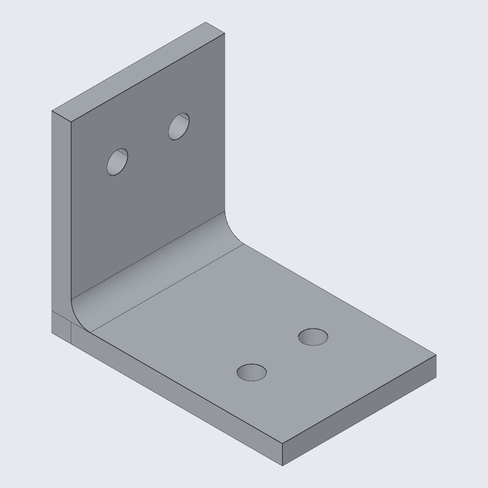

# Silico

Silico is a parametric CAD system written in Rust, with OpenCascade as its geometry kernel. Agents and people are equal users: an AI agent drives it over MCP with the same commands the app's buttons use. Its models are plain text files that diff and merge in git.



*An agent built this bracket from a written spec through `silico serve`: two boxes fused, an inside fillet, and four holes pocketed from sketches. It then checked the part, measured it, rendered it, and exported a printable 3MF. The transcript is in [docs/walkthrough/m4-live/](docs/walkthrough/m4-live/).*

## What's different

- **Agent-native.** Every capability is a command in one API, and the app, the MCP server, and the CLI are equal clients of it. An agent reads the model's faces and edges by name with their geometry, measures, renders offscreen, undoes, and gets errors as structured data: a code, the elements involved, and a suggestion.
- **Git-native.** A document is canonical JSON: a timeline of features, each with the measures it rebuilt to. A reference to geometry is a readable name built from the part's history, not an index: `merge000.fuse.Edge(G base0000.box.Face6, G rght0000.box.Face2)` is the edge where two boxes meet. When an upstream edit breaks a reference, the rebuild fails and names its candidates. It never silently points at different geometry. `silico textconv` makes `git diff` show a model's changes feature by feature ([docs/cli.md](docs/cli.md) sets it up).
- **Exact and deterministic.** OpenCascade is built from source with a pinned recipe, so a document rebuilds bit for bit on macOS and Linux, checked by a 605-case stress test against a committed reference. Results are checked against FreeCAD, as an oracle, case by case.
- **FreeCAD's behaviour, ported.** The kernel's behaviour, the sketcher's solver (FreeCAD's PlaneGCS), and the naming scheme follow FreeCAD's, and each ported subsystem has a note in [docs/ports/](docs/ports/) with the edge cases and bug fixes taken from FreeCAD's history. The app's behaviour follows SolidWorks and its layout follows Fusion 360.
- **Crash-proof by design.** OpenCascade and the solvers run in worker processes behind a typed protocol. A crash, a hang, or a bad reply becomes an error, never a crashed app.

```json
{
  "id": "rnd00000",
  "type": "fillet",
  "v": 1,
  "name": "Inside fillet",
  "base": "merge000",
  "edges": ["merge000.fuse.Edge(G base0000.box.Face6, G rght0000.box.Face2)"],
  "radius": 5
}
```

*A fillet from the bracket's document, its stored fingerprint left out.*

## Status

Silico is a work in progress. These are built and tested:

- **The kernel layer:** primitives, booleans, extrude and revolve, fillet and chamfer, and display meshes.
- **The document:** history, topological naming, references by name, and fingerprints.
- **The sketcher:** constraints solved as FreeCAD solves them, with conflicts and redundancy named; pad, pocket, revolve, and groove from a sketch; sketches on a model's faces.
- **The command API, and the MCP server over it:** offscreen rendering, measurement, and 3MF and STEP export.

The app (milestone M5) is under way. It has:
- the window, timeline, browser, and properties panel;
- the 3D viewport, with picking and selection;
- feature dialogs, including fillet and chamfer from the selected edges;
- undo and redo, and untitled parts;
- a banner, when the file changes on disk (an agent's save, say), listing what changed and offering to restore your version.

Sketch mode in the app and the end-to-end slice are next. See [ROADMAP.md](ROADMAP.md).

## Build and run

You need [pixi](https://pixi.sh) and [rustup](https://rustup.rs), on macOS 15 or later (Apple silicon) or Linux (x86-64). The first build compiles OpenCascade, which takes a few minutes, and later builds reuse it.

```bash
pixi run app     # build everything and open the app
pixi run build   # build everything into target/debug/ (the CLI is target/debug/silico)
pixi run test    # every test
pixi run oracle  # every oracle case, compared with FreeCAD
```

The CLI (`target/debug/silico`) checks, formats, shows, and exports documents: `silico check FILE`, `silico fmt FILE`, `silico export FILE out.3mf` ([docs/cli.md](docs/cli.md)). To connect an agent, run `silico serve --workspace DIR` as an MCP server over stdio; [docs/mcp.md](docs/mcp.md) covers setup and the workflow.

## Pull requests and CI

CI runs on the maintainer's own machine, through self-hosted GitHub Actions runners, so it never runs a fork's code: a pull request from a fork gets no gate (its run waits for an approval no maintainer gives, and approved, its `gate` job is skipped), and it can't be merged until its exact commit passes the gate as a branch of this repository.

Pushing a fork's commit here runs it on those runners, with this repository's token, before any gate has looked at it: a workflow it adds or edits runs on the push, and the gate builds and runs its build scripts, proc macros, tests, and pixi tasks. So only the maintainer does it, by hand, after reading the change:

```bash
gh pr checkout N    # the fork's head, locally
git fetch origin
git diff --stat origin/main...HEAD -- .github .cargo pixi.toml pixi.lock Cargo.lock \
  rust-toolchain.toml 'tests/*.sh' '**/build.rs'
```

If that lists anything, don't push it: a change to CI, the toolchain, the dependencies, or a build script comes in as the maintainer's own commit, not a fork's. Otherwise, read every changed file that runs (build scripts, proc macros, tests, scripts), not only the feature, then:

```bash
git push origin HEAD:refs/heads/fork-pr-N       # the same commit, as a branch here
gh pr create --draft --fill --head fork-pr-N    # its gate runs on that pull request
```

The gate posts its verdict as the commit status `silico/gate`, which `main` requires, on that commit, so the fork's pull request shows it too, and either pull request can then be merged. Each new push to the fork is read and pushed again the same way. Never approve a fork's workflow run: GitHub would run its workflow files, which a fork can change, on the self-hosted runners.

## Read more

- [ARCHITECTURE.md](ARCHITECTURE.md): the design and its invariants.
- [docs/walkthrough/m4.md](docs/walkthrough/m4.md): how the pieces fit, and how to check them yourself.
- [ROADMAP.md](ROADMAP.md): what's built and what comes next.

## License

Silico is licensed under the [GNU Affero General Public License v3.0 or later](LICENSE). Third-party code keeps its own license: PlaneGCS (from FreeCAD) under the LGPL-2.1-or-later in [third_party/planegcs/](third_party/planegcs/), and the fonts under the SIL Open Font License in [crates/silico-font/](crates/silico-font/).
